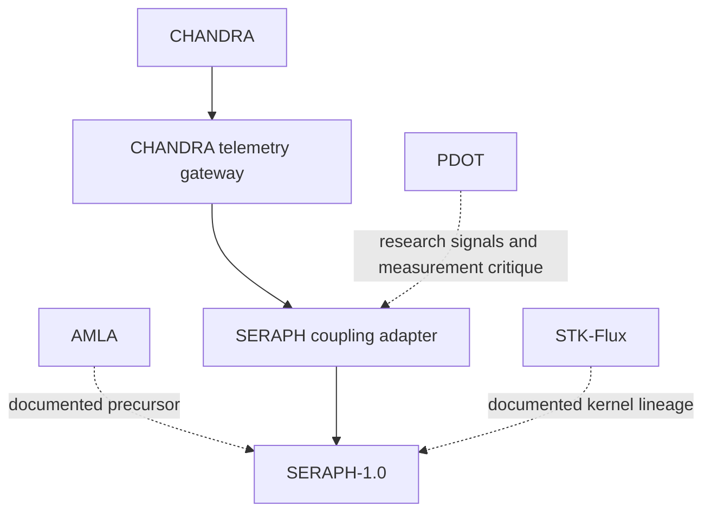

# Repositories that explicitly name SERAPH

Reviewed 2026-10-14. This map includes only repositories whose inspected, pinned public documentation explicitly names SERAPH: AMLA, CHANDRA, STK-Flux, PDOT, and SERAPH-1.0. Inclusion is based on an existing source statement, not an inferred similarity. The named relationships range from precursor work to implemented telemetry interfaces; naming SERAPH does not itself establish a live deployment or runtime dependency.

Exact source snapshots, Git blob IDs, and SHA-256 digests are recorded under `research_stack_sources` in the [provenance manifest](provenance/evidence.json).

## Documented connections

| Repository | Its place in the program | Connection to SERAPH and current boundary |
| --- | --- | --- |
| **[CHANDRA](https://github.com/Ambercontinuum/CHANDRA/blob/ad7ac98d8291dcc52f2ec4a2e99849ef241f3cc3/README.md)** | Prototype conversation diagnostics: CHN classification, symbolic-pressure detection, and continuous coupling telemetry through its PSI integration. | **Implemented SERAPH-side interface.** [`ChandraSERAPHGateway`](../adapters/chandra_seraph.py) accepts raw coupling and pressure values and passes them through [`CouplingFieldAdapter`](../adapters/coupling_field.py). It maintains per-session trajectory and recovery evidence. It does not import CHANDRA's classes or certify the diagnostic measurements. |
| **[AMLA](https://github.com/Ambercontinuum/AMLA/blob/21760b3c246c9f98d8b295e9e9ffc2517e4cb475/README.md)** | An adaptive multimodal learning prototype and interaction surface for observing context analysis, support routing, and response adaptation. Its README explicitly identifies it as a SERAPH-family precursor. | **Documented precursor and potential governed host.** The inspected [`analyze_context`](https://github.com/Ambercontinuum/AMLA/blob/21760b3c246c9f98d8b295e9e9ffc2517e4cb475/utils/chandraAnalysis.ts) returns support level, mode, and indicator counts; the Gemini service uses context analysis in generation. This output is not already SERAPH's four-component coupling schema. The SERAPH gateway mentions AMLA, but that alone does not demonstrate an end-to-end AMLA deployment or a complete telemetry conversion. |
| **[STK-Flux](https://github.com/Ambercontinuum/STK-Flux/blob/e702716df9707d2c2c14db39a7e5c6cd989bdfbd/README.md)** | A Lean/Python coupling kernel for lambda, kappa, theta, epsilon, mode history, oscillation, recovery, and commit/hold routing. Its README identifies it as a precursor informing later SERAPH-family governance work. | **Documented kernel lineage and shared telemetry vocabulary.** SERAPH's coupling adapter and trajectory/recovery model address these same variables and concerns. SERAPH has its own implementation; it does not depend on importing STK-Flux. STK's 0–100 interface and SERAPH's 0–1 coupling interface are not directly interchangeable without an explicit conversion. No equivalence proof between the two kernels is claimed. |
| **[PDOT](https://github.com/Ambercontinuum/PDOT/blob/172b1158468d0be6e010c1627cb77c5155536161/README.md)** | The preregistered measurement program for anchoring, coherence, autonomy, drift, pressure, and perturbation recovery. | **Measurement and critique track, with an implemented research adapter.** [`analysis/pdot_seraph_adapter.py`](https://github.com/Ambercontinuum/PDOT/blob/172b1158468d0be6e010c1627cb77c5155536161/analysis/pdot_seraph_adapter.py) scores transcript windows, transforms scores into coupling signals, and performs its own deterministic routing. It is not itself a call into the current SERAPH runtime. The [May 16 lineage document](https://github.com/Ambercontinuum/PDOT/blob/2ff1ae873495d79d2632e202b58632a3a442448f/docs/csa_seraph_lineage.md) explicitly connects the programs. Public methods do not by themselves validate the measurements or current runtime thresholds. |
| **[SERAPH-1.0](https://github.com/Ambercontinuum/SERAPH-1.0/tree/9d8d7c25a6315fa4c7cb9c1b80c1785afbbe9668)** | The executable governance sidecar that brings scoped constraints, transition coherence, recovery, guardian integrity, environment, coupling, and consequence monitoring into one runtime. | **The runtime convergence point.** [`seraph/`](../seraph/), [`adapters/`](../adapters/), [`formal/`](../formal/), and [`validation/`](../validation/) contain the implementation and its bounded evidence. Accepted telemetry cannot override failed hard constraints. Execution binding and monitoring remain subject to the documented [verification boundary](../README.md#verification-boundary). |

## Connection map

Solid arrows denote an implemented SERAPH-side interface. Dotted arrows denote explicitly documented precursor relationships or a research handoff. They do not imply a live end-to-end deployment.

## Evidence boundary

AMLA, CHANDRA, and STK-Flux explicitly describe their relationship to the later SERAPH family in their pinned READMEs. PDOT's README names its SERAPH-compatible adapter, and its earlier lineage document names the governance runtime. SERAPH-1.0 is the runtime repository itself.

The review inspected those public documents, selected integration sources, and SERAPH's local implementation. External projects were not executed, their empirical claims were not independently validated, and conceptual lineage is not represented as an installed dependency. SERAPH's telemetry observations remain subject to its [verification boundary](../README.md#verification-boundary).
